# RedLightWatch

**Edge red-light violation detector for an NVIDIA Jetson Orin Nano.** It watches a traffic-camera video, reads the traffic light, tracks every vehicle, and flags the cars that cross the stop line while the light is red.

<p align="center">
  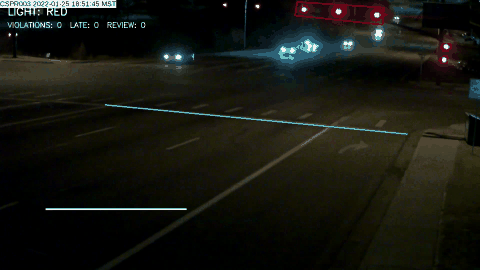
</p>
<p align="center"><em>clip1 (night): the light is red and car #10 crosses the stop line, so it is flagged as a VIOLATION.</em></p>

## How it works

<p align="center">
  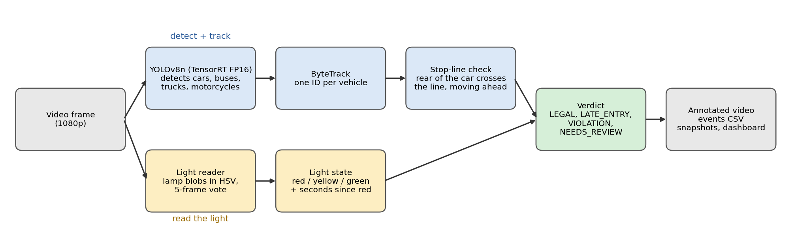
</p>

1. **Detect + track.** YOLOv8n finds cars, motorcycles, buses and trucks (TensorRT FP16 engine). ByteTrack gives each vehicle an ID.
2. **Read the light.** The traffic-light region is cropped, lamp blobs are found by brightness, and the colour is read from the ring around the lamp core (overexposed lamps look white in the middle). A 5-frame majority vote smooths the result.
3. **Stop-line crossing.** A vehicle's bottom-centre point must move from the approach side to the far side of the stop line, driving forward. A 10 px band around the line ignores jitter.
4. **Verdict**, at the moment of crossing: green is LEGAL; yellow, or red for less than 1 s, is LATE_ENTRY; red for longer is a VIOLATION (NEEDS_REVIEW if the detection confidence is under 0.5 or the light is unreadable).
5. A vehicle that comes back behind the line within 1.5 s is downgraded to NEEDS_REVIEW. A clip with 3 or more violations flags the intersection as HIGH-RISK.

## Demo: all 9 test clips

Each GIF is the annotated output of the detector (light colour, vehicle boxes, counters, verdict). Clip 1 is shown at the top.

| | | | |
|---|---|---|---|
| 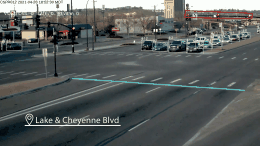<br>**clip2**: VIOLATION, car #27 at 5.84 s | 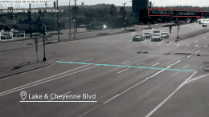<br>**clip3**: VIOLATION, car #18 at 6.17 s | 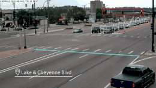<br>**clip4**: VIOLATION, car #32 at 4.67 s | 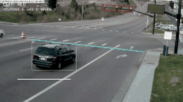<br>**clip5**: VIOLATION, car #2 at 7.88 s |
| 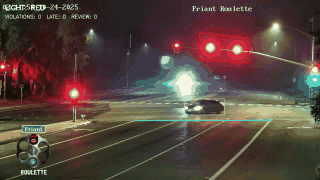<br>**clip6**: no violation | 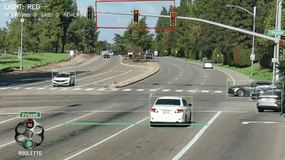<br>**clip7**: VIOLATION, car #1 at 0.57 s | 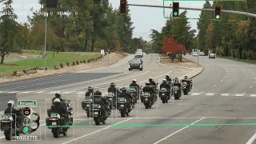<br>**clip8**: green light, 7 legal crossings | 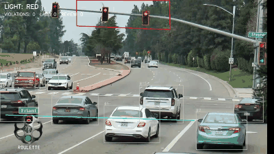<br>**clip9**: VIOLATION, car #3 at 0.83 s |

### Full annotated videos

The complete annotated output for each clip (click to play on GitHub): [clip1](docs/videos/clip1_annotated.mp4) · [clip2](docs/videos/clip2_annotated.mp4) · [clip3](docs/videos/clip3_annotated.mp4) · [clip4](docs/videos/clip4_annotated.mp4) · [clip5](docs/videos/clip5_annotated.mp4) · [clip6](docs/videos/clip6_annotated.mp4) · [clip7](docs/videos/clip7_annotated.mp4) · [clip8](docs/videos/clip8_annotated.mp4) · [clip9](docs/videos/clip9_annotated.mp4)

## What the detector sees

The plot shows the traffic-light colour the detector read in each clip, with every car that crossed the stop line marked on it. Every violation (black X) falls inside a red phase; every legal crossing (white circle) falls inside a green phase.

<p align="center">
  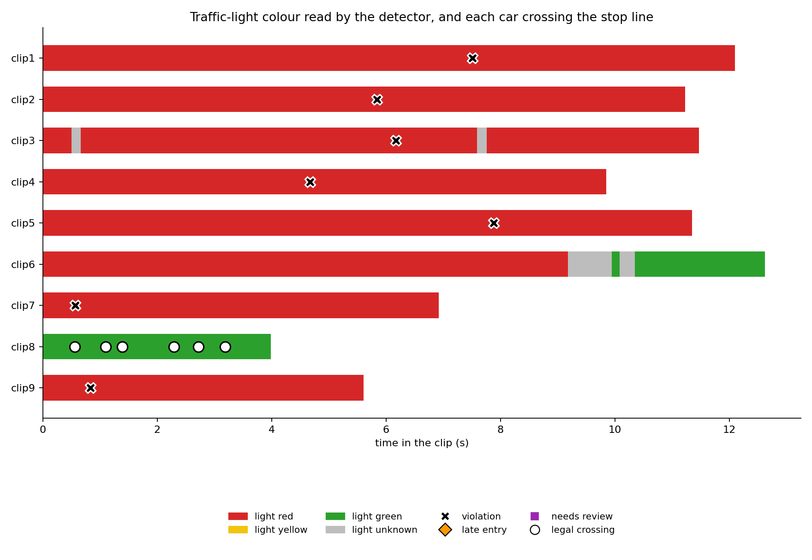
</p>

The 7 violations the detector confirmed, at the moment each car crossed the line:

<p align="center">
  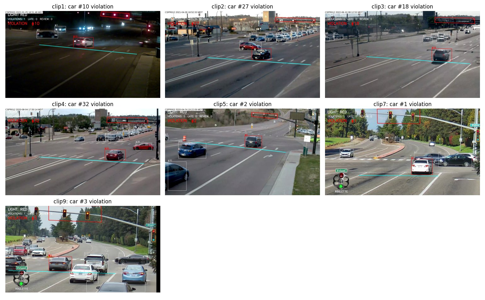
</p>

## Results

Per-clip counts against hand-labelled ground truth (TensorRT FP16, 960 px input):

| Clip | Real runners | Confirmed violations | TP | FP | FN | Legal |
|---|---|---|---|---|---|---|
| clip1 | 1 | 1 | 1 | 0 | 0 | 0 |
| clip2 | 1 | 1 | 1 | 0 | 0 | 0 |
| clip3 | 1 | 1 | 1 | 0 | 0 | 0 |
| clip4 | 1 | 1 | 1 | 0 | 0 | 0 |
| clip5 | 1 | 1 | 1 | 0 | 0 | 0 |
| clip6 | 0 | 0 | 0 | 0 | 0 | 0 |
| clip7 | 1 | 1 | 1 | 0 | 0 | 0 |
| clip8 | 0 | 0 | 0 | 0 | 0 | 7 |
| clip9 | 1 | 1 | 1 | 0 | 0 | 0 |

**9 clips: TP = 7, FP = 0, FN = 0, precision 100%, recall 100%.** The raw files are in `results/`.

### Speed

<p align="center">
  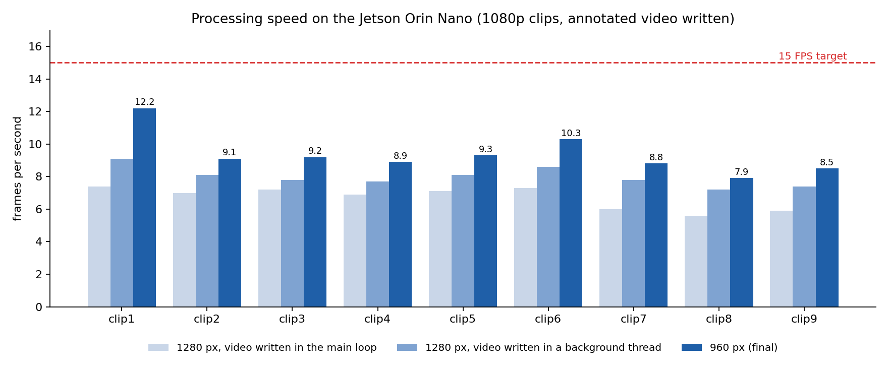
</p>

With the annotated video written, the final setup runs at **8 to 12 FPS** on the Orin Nano (up to 13 FPS with video output off). Moving to a 960 px model input and writing the video in a background thread took it from about 6 to about 9 FPS on average. The 15 FPS target was **not** reached; this is still real-time for the 1080p test clips at about 10 to 12 frames of analysis per second.

## Dashboard

A Streamlit dashboard runs the detector on a sample clip or on a video you upload. For an upload you click on a preview frame to mark the stop line and the traffic light, then press **Run detection**. It shows the violation counters, the annotated video, the events table, the violation snapshots and a CSV download.

<p align="center">
  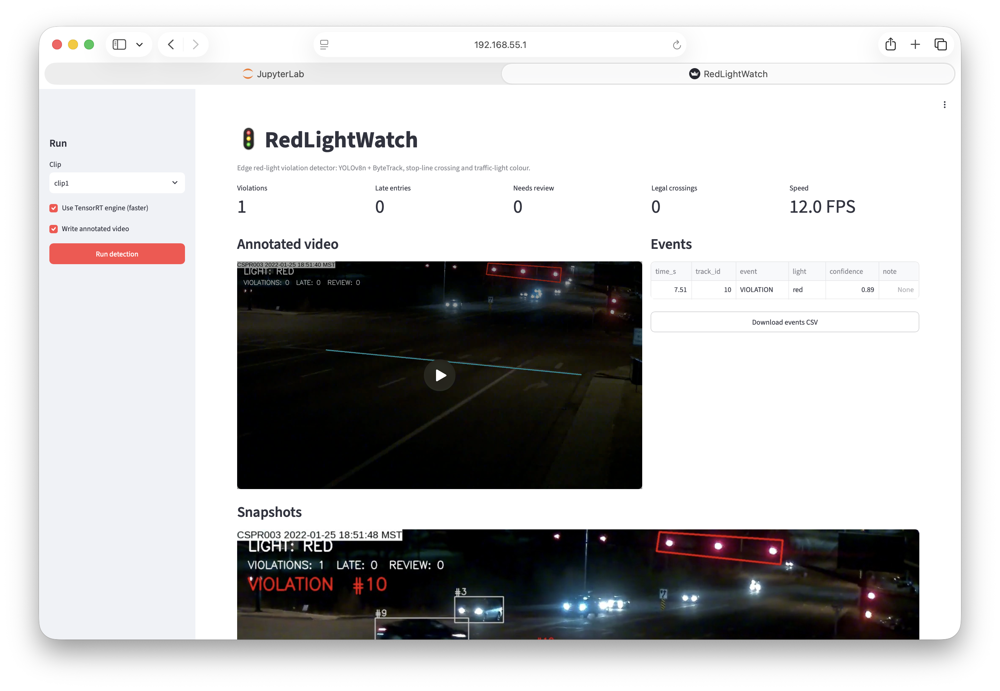
</p>
<p align="center">
  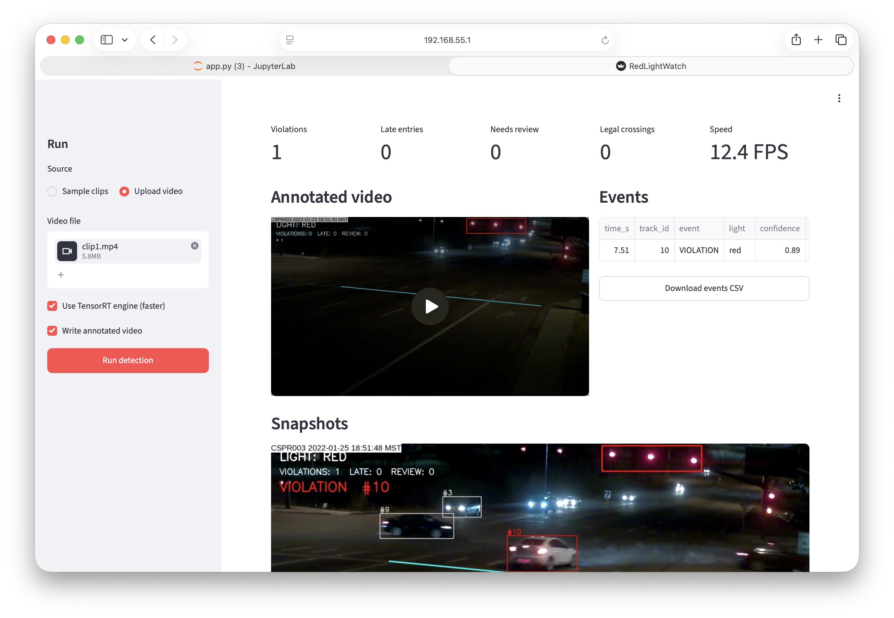
</p>

## Project layout

```
backend/
  config.py               stop line and light region for each clip
  light.py                traffic-light colour reader
  light_state.py          light-only timeline + video (to check the reader)
  detect_violations.py    main pipeline (detect, track, judge, save)
  evaluate.py             scores the outputs against ground truth
  profile_pipeline.py     per-stage timing
  make_readme_assets.py   builds the GIFs and plots used in this README
frontend/app.py           Streamlit dashboard
data/clips/               the 9 test videos
results/                  final run: evaluation.csv, events CSV per clip, snapshots, run logs
docs/                     GIFs and images used in this README
requirements.txt
```

## Setup (Jetson, Docker)

Docker image: `ultralytics/ultralytics:latest-jetson-jetpack6`

```bash
git clone https://github.com/aadityaa-dava/red-light-watch.git
cd red-light-watch
docker run -it --rm --runtime nvidia --ipc=host \
  -p 8889:8889 -p 8501:8501 \
  -v ~/red-light-watch:/app -w /app \
  ultralytics/ultralytics:latest-jetson-jetpack6 bash
# inside the container:
pip install supervision lap matplotlib streamlit streamlit-image-coordinates
apt-get update && apt-get install -y ffmpeg      # plays the annotated video in the browser
```

Optional TensorRT engine (about 10 minutes to build, much faster inference):

```bash
yolo export model=yolov8n.pt format=engine half=True imgsz=960 device=0
mv yolov8n.engine yolov8n_960.engine
```

## Run

```bash
python3 backend/detect_violations.py clip1                     # PyTorch model
RLW_IMGSZ=960 RLW_MODEL=yolov8n_960.engine \
  python3 backend/detect_violations.py clip1                   # TensorRT engine
RLW_NOVIDEO=1 python3 backend/detect_violations.py clip1       # skip the output video (faster)
python3 backend/evaluate.py                                    # score all 9 clips
streamlit run frontend/app.py --server.port 8501 --server.address 0.0.0.0
```

Outputs go to `outputs/`: `<clip>_violations.mp4`, `<clip>_events.csv` and `outputs/violations/<clip>_id<N>_<EVENT>.jpg`. Open the dashboard at `http://<jetson-ip>:8501` (`192.168.55.1` over the USB link). To rebuild the GIFs and plots in this README: `python3 backend/make_readme_assets.py`.

## Limitations

- Thresholds and the line/light regions were tuned on these same 9 clips; there is no held-out test set, so accuracy on new cameras will be lower.
- Evaluation compares counts per clip, not individual cars.
- The stop line and the light region are set by hand for each camera (the dashboard lets you click them).
- Clips 7 to 9 have a variable frame rate and camera zoom or pan, which can move the line relative to the road.
- Night, glare and heavy rain make light reading and detection less reliable.